# ChronoMap 3D: 3-Minute Video Script with Screenshots

**AI-drafted starting point.** Read it aloud, rewrite anything that doesn't sound like you, and replace each `[INSERT]` with real information. About 360 words of narration, roughly 2½ minutes at a steady pace, which leaves room for clicks and pauses to reach 3 minutes. `[INSERT: confirm the required video length.]`

**How to use this page.** Each scene shows the screens you'll be on, the exact taps to make, and the narration. **Bold text in brackets inside the narration** is a click cue: tap that thing when you reach those words. Screenshots are in `docs/video-assets/`.

**Recording setup:** Figma → Page 1 - Hi Fi → Prototype tab → Present. Scenes 1 to 6 run as one continuous path from the flow _ChronoMap · full journey_. Scene 7 starts from the flow _Home (skip onboarding)_. Click slowly and let the narration finish before moving on.

**Suggested speakers:** John (1–2), Dhiraj (3–4), Yong En (5–6), Ashlesha (7–8).

---

## Scene 1 · The idea (0:00–0:20)

<table><tr>
<td align="center">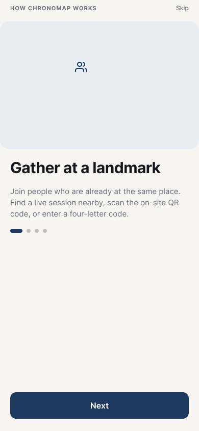 01 Onboarding</td>
</tr></table>

**Taps:** start on 01. At the end, tap **Next**, which goes to 02.

> "Most 3D models of real places need expensive equipment, or come from platforms that pick which places get covered. ChronoMap 3D is different: people standing at the same place photograph it together, in one shared time window, and the photos become a 3D recreation. It uses crowdsourcing, co-location and synchronicity. **[tap Next]**"

---

## Scene 2 · Home, Community and requests (0:20–0:45)

<table><tr>
<td align="center">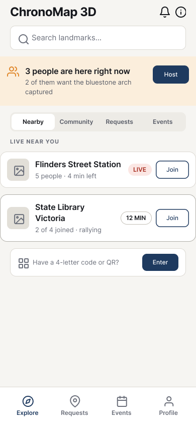 02 Home</td>
<td align="center">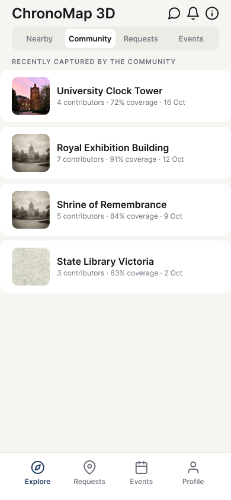 21 Community</td>
<td align="center">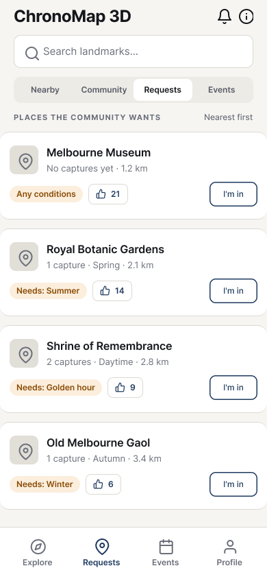 03 Requests</td>
</tr></table>

**Taps:** on 02, tap the **Community** tab (21), then the **Requests** tab (03).

> "The home screen shows live sessions nearby. **[tap Community]** The Community tab shows what others have captured, **[tap Requests]** and the Requests tab is a demand board where people vote for places they want captured. The crowd decides where to go."

---

## Scene 3 · Rules, rally and briefing (0:45–1:10)

<table><tr>
<td align="center">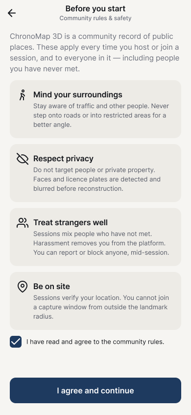 07 Rules</td>
<td align="center">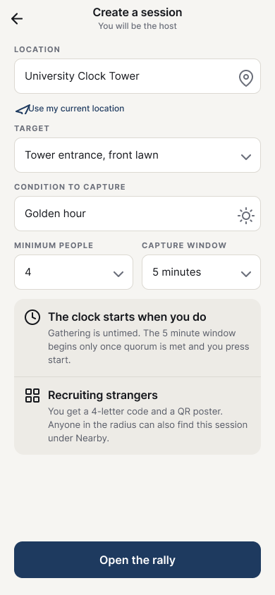 08 Create session</td>
<td align="center">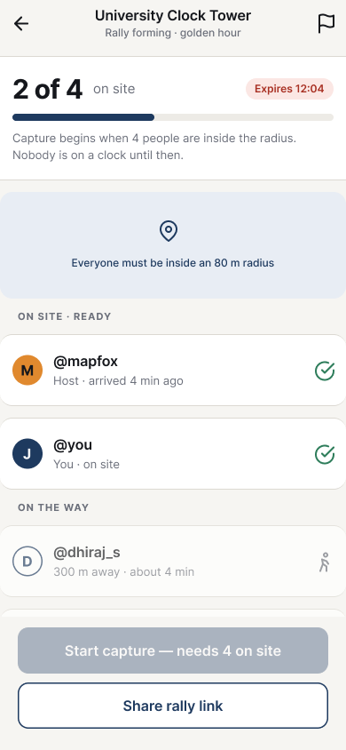 09 Rally</td>
<td align="center">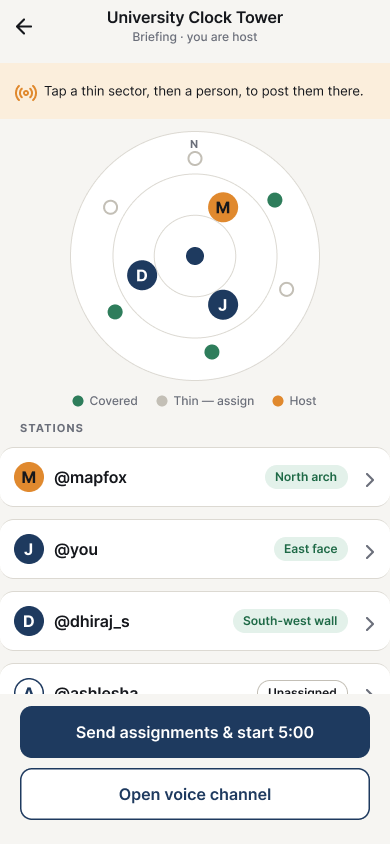 10 Briefing</td>
</tr></table>

**Taps:** on 03, tap **Explore** (bottom bar) to return to 02, then **Host** on the yellow banner (07). Then **I agree and continue** (08), **Open the rally** (09), **Start capture** (10).
_Optional cut-in:_ 11 "Your station" shows what a participant sees, but it isn't on this click path, so open it from the frame list if you want it.

> "Hosts agree to the community rules **[tap I agree and continue]**, then set a target and a minimum number of people **[tap Open the rally]**. You can only join from inside the landmark radius, because being in the same place is the point **[tap Start capture]**. The host then assigns each person a station on a coverage radar."

---

## Scene 4 · Voice and live capture (1:10–1:45)

<table><tr>
<td align="center">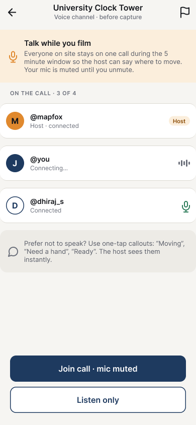 13 Voice channel</td>
<td align="center">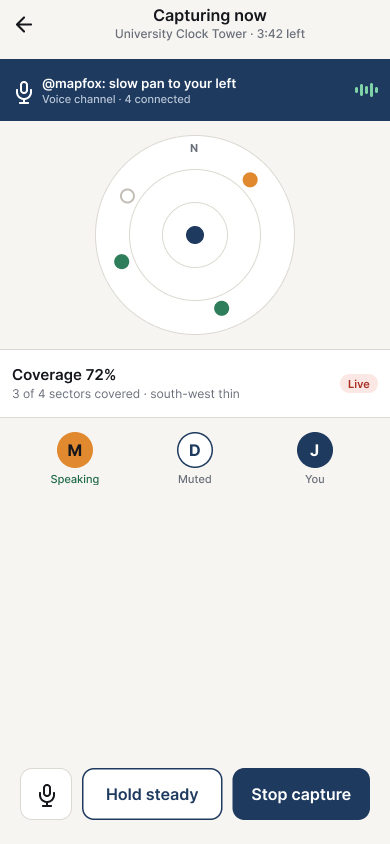 14 Live capture</td>
<td align="center">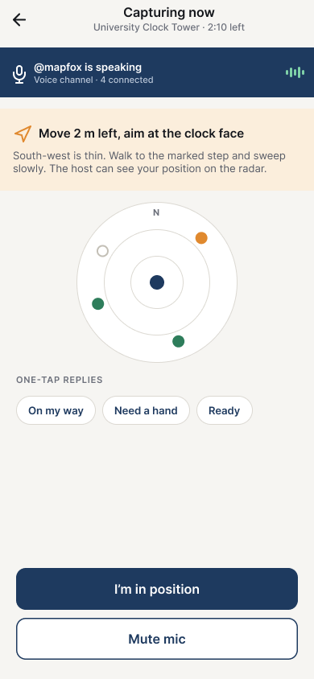 15 Host callout</td>
</tr></table>

**Taps:** on 10, tap **Open voice channel** (13), **Join call · mic muted** (14), **Hold steady** (15), then **I'm in position** to return to 14.

> "During capture, everyone is on one voice call, muted by default. **[tap Join call]** The host says where to move, **[tap Hold steady]** and people who would rather not speak can answer with a one-tap reply like 'On my way'. A timer shows the shared window, and the radar shows which sides are covered and which are thin. This is the synchronous, co-located part of the system. **[tap I'm in position]**"

---

## Scene 5 · Flagging a participant live (1:45–2:10)

<table><tr>
<td align="center"> 14 Live capture</td>
<td align="center">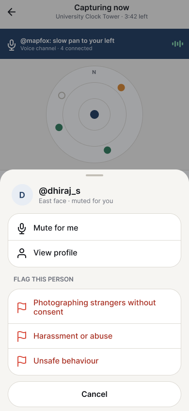 14a Participant menu</td>
<td align="center">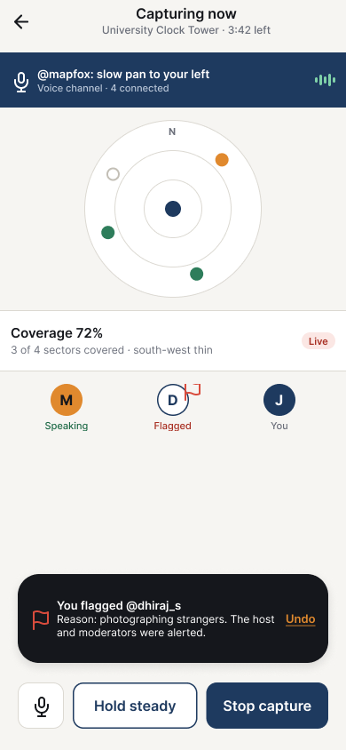 14b Flagged (red)</td>
</tr></table>

**Taps:** on 14, tap **D** (the "Muted" participant) to open 14a, then **Photographing strangers without consent** (14b).

> "Safety works live. If someone is photographing strangers, **[tap D]** tap them, and a sheet opens at the bottom. You can mute them, view their profile, or flag them. **[tap Photographing strangers without consent]** The flag turns red, and the host and moderators are alerted at once. Their photos are held out of the model until someone has reviewed them."

---

## Scene 6 · Artifact and sharing (2:10–2:30)

<table><tr>
<td align="center">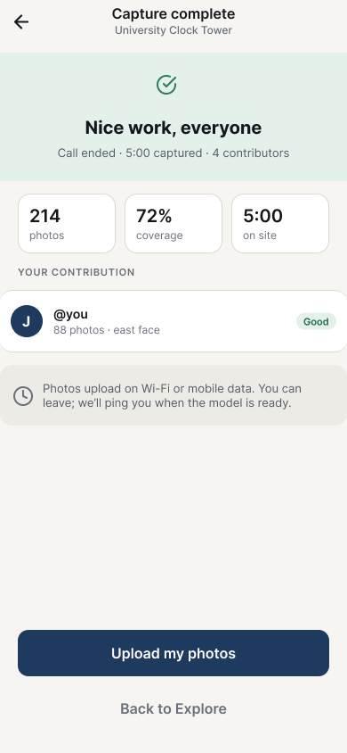 16 Capture complete</td>
<td align="center">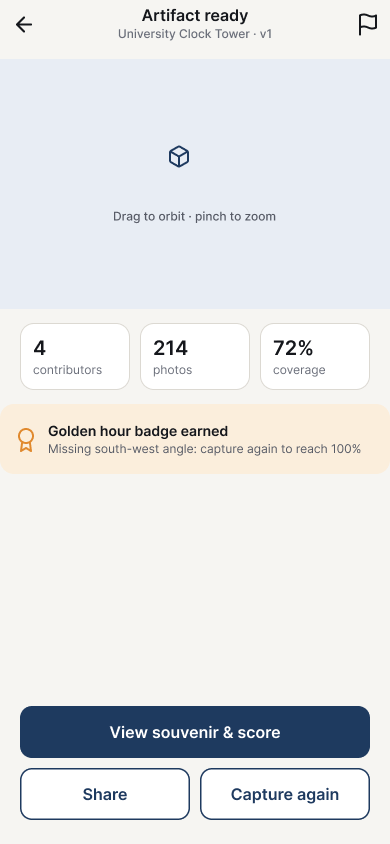 18 Artifact</td>
<td align="center">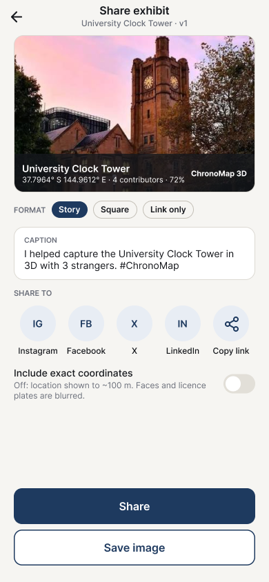 20 Share</td>
</tr></table>

**Taps:** on 14b, tap **Stop capture** (16), **Upload my photos** (17, a quick processing screen), **Notify me when ready** (18), then **Share** (20).

> "When the window closes **[tap Stop capture]**, the group sees what it made, **[tap Upload my photos, then Notify me when ready]** and the 3D model appears as an exhibit, with where and when it was captured, who took part, and how complete it is. Our reconstruction is simulated in this prototype. **[tap Share]** Users can share a card to social media, with exact coordinates off by default and faces blurred."

---

## Scene 7 · Reporting and moderation (2:30–2:45)

<table><tr>
<td align="center">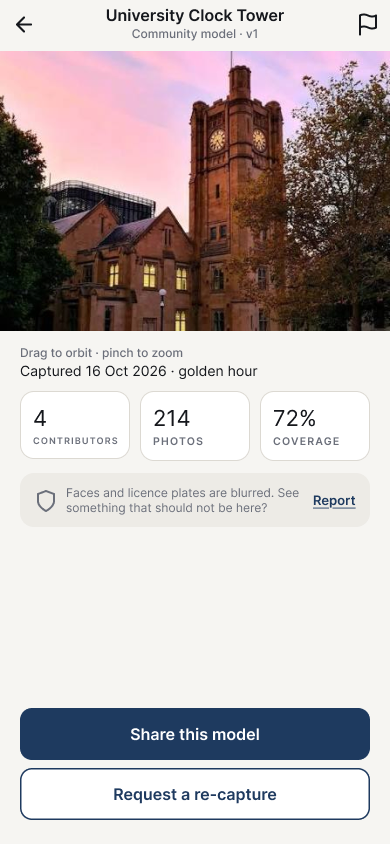 22 Community model</td>
<td align="center">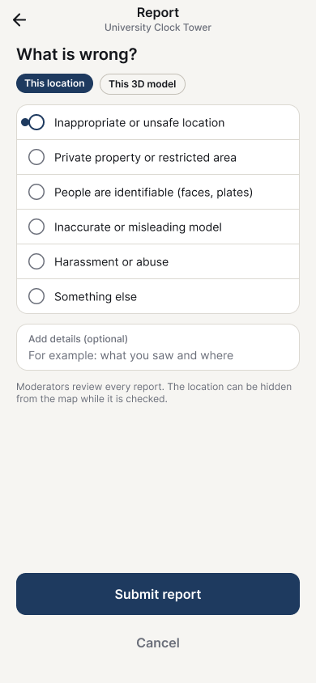 23 Report</td>
<td align="center">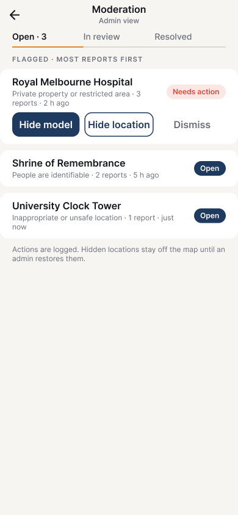 25 Moderator queue</td>
</tr></table>

**Taps (start a new recording from the flow _Home (skip onboarding)_):** tap **Community** (21), the **University Clock Tower** row (22), the **flag** in the header (23), **Submit report** (24), **Moderator view (demo)** (25).

> "Anyone can report a model or a location, **[tap the flag]** for example a place that isn't appropriate to film. **[tap Submit report]** Moderators work from a queue **[tap Moderator view]** and can hide the model, hide the location, or dismiss the report."

---

## Scene 8 · Design, evaluation and close (2:45–3:00)

<table><tr>
<td align="center"> Original 02</td>
<td align="center">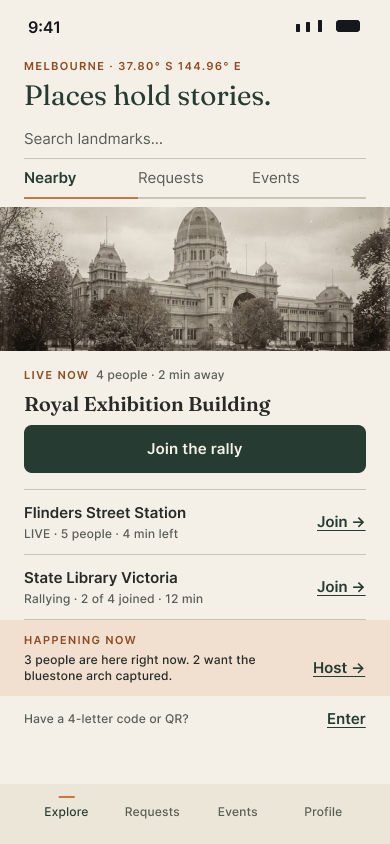 Editorial 02</td>
<td align="center"> Original 14</td>
<td align="center">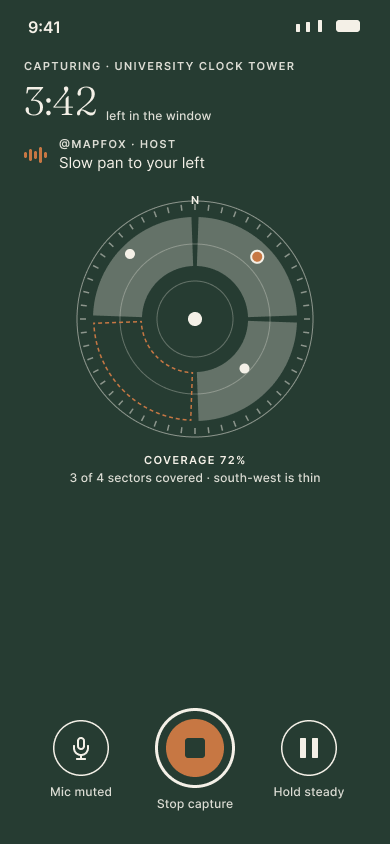 Editorial 14</td>
<td align="center"> Original 18</td>
<td align="center">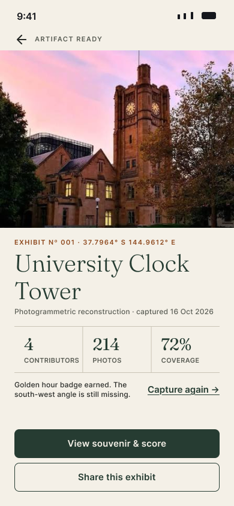 Editorial 18</td>
</tr></table>

**On screen:** show original and editorial pairs side by side, then a closing title card. This scene is a static image, not a click-through.

> "We redesigned the look to feel like an archive field journal and checked accessibility. `[INSERT: our evaluation, the number of participants and the main finding.]` Next we want to connect real reconstruction and test at a real landmark. Thanks for watching."

---

## Checks before recording

- All numbers on screen (contributors, photos, coverage) are sample data. Say "sample" if viewers might read them as results.
- Do not state an evaluation result unless it came from real testing. If we haven't evaluated yet, replace the bracket in scene 8 with what we plan to evaluate and how.
- The clock tower photo was supplied by the team `[INSERT: source and licence]`. The other photos are AI-generated placeholders.
- These screenshots were taken from the Figma file today. If the design changes, re-export the affected screens.
- If we run over 3 minutes: shorten scene 2, then scene 7.
- Every speaker should be able to explain their scenes in the oral assessment. Reasons for design choices are in `docs/design-decision-log.md`.
